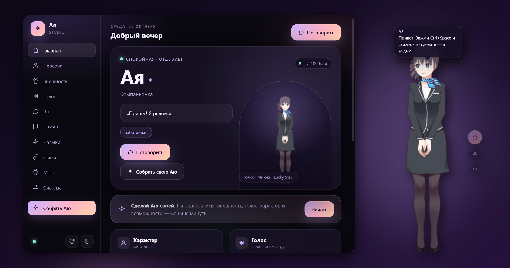
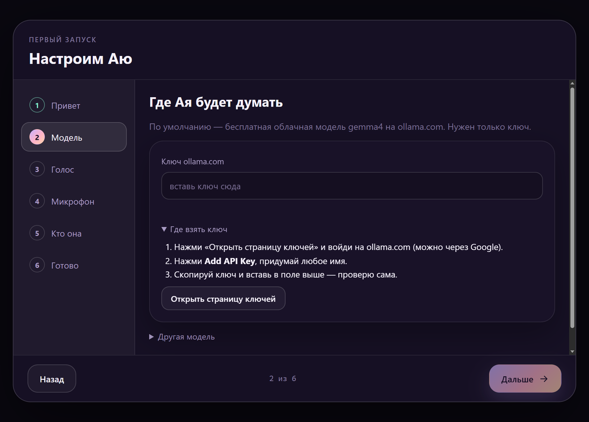
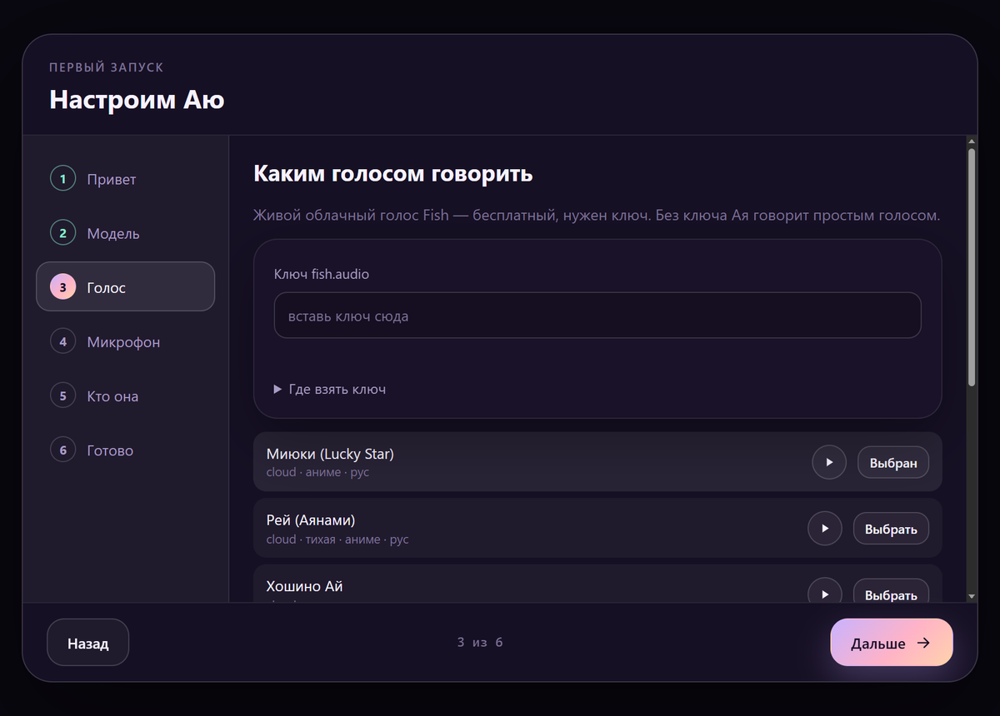
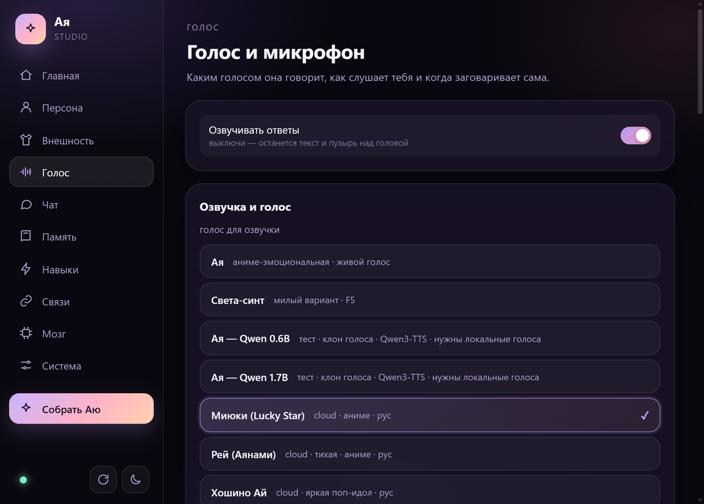
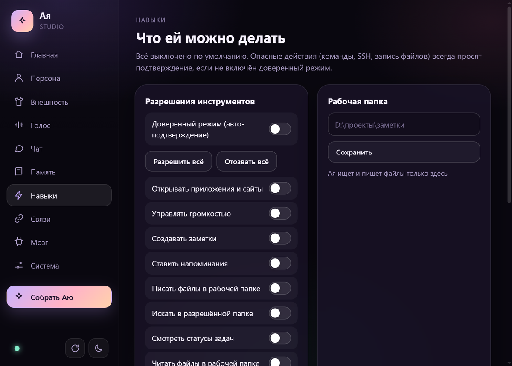
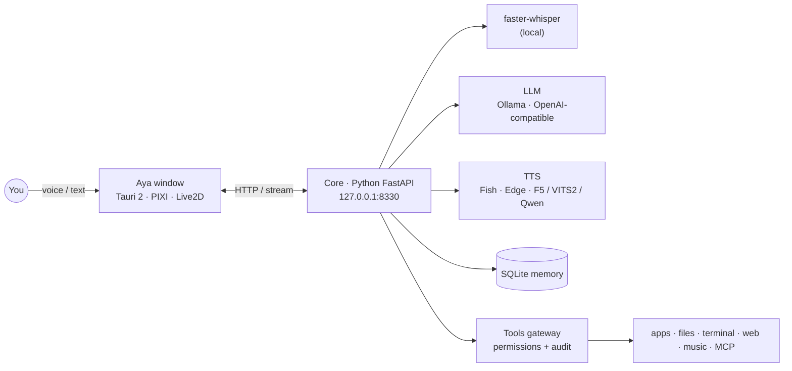

<div align="center">



# Aya

### A living anime companion for your Windows desktop.<br>She talks, listens, remembers — and actually gets things done.

[](https://github.com/parh0m2007/Aya/releases/latest)
[](https://github.com/parh0m2007/Aya/releases)
[](https://github.com/parh0m2007/Aya/stargazers)
[](LICENSE)
[](https://github.com/parh0m2007/Aya/releases/latest)

**[⬇ Download for Windows](https://github.com/parh0m2007/Aya/releases/latest)** · [Features](#-what-she-can-do) · [Quick start](#-quick-start) · [Build from source](#-build-from-source) · [Русский](README.ru.md)

</div>

---

Aya is a Live2D character that lives **on top of your windows** — not in a browser tab.
Hold a key and talk to her, or just say *“Aya, …”*. She answers out loud, remembers what
you told her last week, plays your music, sets reminders, and — **only with your
permission** — opens apps, searches your files and runs commands for you.

Free to run: the default brain is a **free cloud model** (gemma4 on OpenRouter, no card needed) and the
default voice is **free Fish Audio**. Or bring your own — local Ollama or any
OpenAI-compatible API.

> [!NOTE]
> Aya speaks and understands any language your model does, but the interface is
> **Russian-first** today. An English UI is on the [roadmap](#-roadmap).

## ✨ What she can do

<table>
<tr>
<td width="50%" valign="top">

**🎙 Talk like a person**
Push-to-talk on any key (Ctrl+Space by default — works even when she’s minimized),
hands-free *“Aya, …”* wake word, or text. Speech recognition runs **locally**
(faster-whisper, GPU or CPU); replies stream back by voice in about 2 seconds.

</td>
<td width="50%" valign="top">

**🧠 Remembers you**
Long-term memory in a local SQLite database: facts about you, past conversations
she can recall, a diary of your days together. Everything stays in
`%USERPROFILE%\.aya` on your PC.

</td>
</tr>
<tr>
<td valign="top">

**🛠 Gets things done — safely**
Opens apps and sites, searches and writes files in a folder you choose, runs
terminal commands, SSH, web search, reads your screen (OCR). **Every tool is off by
default**; risky ones always ask first.

</td>
<td valign="top">

**🎵 Music & focus**
“Play some lo-fi” — YouTube or Yandex Music, pause / next / what’s playing.
Music ducks automatically while she speaks. Pomodoro timer and reminders built in.

</td>
</tr>
<tr>
<td valign="top">

**🗣 Voices — including yours**
Free cloud voices (Fish Audio), a zero-setup fallback (Edge TTS), or local voices
(F5-TTS, VITS2, Qwen3-TTS) — **clone any voice from a short sample**, all offline.

</td>
<td valign="top">

**🧩 Extensible**
Connect **MCP servers**, add skills and sub-agents, bridge her to **Telegram** and
**Discord**. Swap in your own **Live2D model** — or build her personality in a
5-step persona constructor.

</td>
</tr>
<tr>
<td valign="top">

**🌸 Alive on your desktop**
Follows your cursor with her eyes, lip-syncs to her own voice, reacts to pats and
pokes, walks along your windows, speaks up on her own when you’ve been working too
long.

</td>
<td valign="top">

**🔌 Any brain you like**
OpenRouter (default, free models), **Ollama on your own PC**, Ollama cloud, or any
**OpenAI-compatible** API — Groq, LM Studio, vLLM… Pick the model from a list, no config files.

</td>
</tr>
</table>

## 📸 A closer look

<table>
<tr>
<td width="50%"><br><sub><b>First run</b> — paste one key, she checks it instantly.</sub></td>
<td width="50%"><br><sub><b>Pick a voice</b> — listen first, skip if you like.</sub></td>
</tr>
<tr>
<td><br><sub><b>Voices</b> — cloud, local, or cloned from your own sample.</sub></td>
<td><br><sub><b>Permissions</b> — every capability is opt-in.</sub></td>
</tr>
</table>

## 🚀 Quick start

1. **[Download `Aya_x64-setup.exe`](https://github.com/parh0m2007/Aya/releases/latest)** and run it.
   No admin rights, no Python, nothing else to install.
2. A short setup opens. Paste a free key from
   **[openrouter.ai/settings/keys](https://openrouter.ai/settings/keys)** (*Create API Key*, no card) — she checks it right away.
   Free models give you 50 replies a day.
3. *(Optional)* For a lively voice, add a free key from
   **[fish.audio → API Keys](https://fish.audio/app/api-keys/)**. Skip it and she uses a simple built-in voice.
4. Pick your mic and a hotkey, give her a name — and say hi. 👋

> [!TIP]
> **“Windows protected your PC”?** That’s the usual SmartScreen warning for apps without
> a paid code-signing certificate. Click **More info → Run anyway**. The installer is built
> in public by [GitHub Actions](.github/workflows/release.yml) from this repository.

Updates arrive in one click — Aya tells you when a new version is out.

### How to talk to her

| | |
|---|---|
| **Hold Ctrl+Space** anywhere and speak | works even when she’s minimized — she answers by voice |
| **“Aya, …”** | hands-free wake word (enable in setup or the console) |
| **Double-click her** | open the text chat |
| **Alt+Shift+A** | show / hide her |

Both hotkeys are configurable: *Console → Voice → Hotkeys*.

## 🔒 Privacy & safety

- **Your data stays on your PC** — settings, memory and chats live in `%USERPROFILE%\.aya`.
  Updates and uninstall never touch it.
- **Nothing runs without your say-so.** All tools start disabled; commands, SSH and file
  writes always ask for confirmation unless you turn on trusted mode yourself. Every action
  is written to an audit log you can read in the console.
- **Keys never leave the core.** The UI only ever sees “key saved”.
- Local speech recognition, local voices and local models mean you can keep **everything offline**.

## 🏗 Under the hood



| Part | Stack |
|---|---|
| Desktop shell | [Tauri 2](https://tauri.app) (Rust), transparent always-on-top window |
| Window & console | TypeScript, Vite, PIXI.js, [pixi-live2d-display](https://github.com/guansss/pixi-live2d-display) |
| Core | Python 3.11, FastAPI, SQLite, bundled with the installer |
| Speech | [faster-whisper](https://github.com/SYSTRAN/faster-whisper), Fish Audio, edge-tts, F5-TTS, VITS2, Qwen3-TTS |

## 🧑‍💻 Build from source

```powershell
git clone https://github.com/parh0m2007/Aya.git
cd Aya
uv venv core\.venv --python 3.11
uv pip install --python core\.venv\Scripts\python.exe -r core\requirements.txt
npm install
mkdir src-tauri\runtime\python, src-tauri\stage\core   # filled by scripts\build-runtime.ps1 for the installer
npm run tauri dev
```

Tests: `npx vitest run` · `core\.venv\Scripts\python -m pytest core\tests` · `cargo test --manifest-path src-tauri\Cargo.toml`

Release: push a `vX.Y.Z` tag — [GitHub Actions](.github/workflows/release.yml) builds the
installer, signs the update and drafts the release.

## 🗺 Roadmap

- [x] Voice chat, wake word, long-term memory, music, tools with permissions
- [x] One-click installer, first-run setup, auto-updates
- [ ] English interface
- [ ] macOS build
- [ ] Plugin gallery for skills and MCP servers
- [ ] More built-in Live2D models

Ideas and bug reports are very welcome — [open an issue](https://github.com/parh0m2007/Aya/issues).

## 💜 Support the project

If Aya made your desktop a little less lonely, **[give the repo a ⭐](https://github.com/parh0m2007/Aya/stargazers)** —
it’s the easiest way to help more people find her. Pull requests, translations and new
Live2D models are just as welcome.

<a href="https://star-history.com/#parh0m2007/Aya&Date">
  
</a>

## 📄 License & credits

Code: **MIT** — see [LICENSE](LICENSE).
Live2D model *Haru* and the Cubism SDK belong to Live2D Inc. and are used under their
licenses. Local voice weights are downloaded by you from Hugging Face under their own
licenses ([F5-TTS_RUSSIAN](https://huggingface.co/Misha24-10/F5-TTS_RUSSIAN) is CC BY-NC 4.0 —
non-commercial). Thanks to the authors of Tauri, faster-whisper, Fish Audio, edge-tts,
F5-TTS, Qwen3-TTS and pixi-live2d-display.
