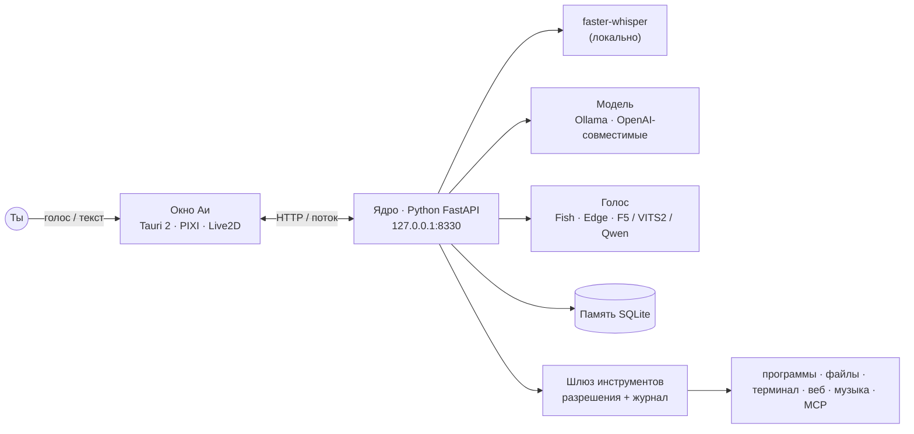

<div align="center">


# Ая

### Живая аниме-помощница на рабочем столе Windows.<br>Говорит, слушает, помнит — и правда помогает с делами.

[](https://github.com/parh0m2007/Aya/releases/latest)
[](https://github.com/parh0m2007/Aya/releases)
[](https://github.com/parh0m2007/Aya/stargazers)
[](LICENSE)
[](https://github.com/parh0m2007/Aya/releases/latest)

**[⬇ Скачать для Windows](https://github.com/parh0m2007/Aya/releases/latest)** · [Возможности](#-что-она-умеет) · [Быстрый старт](#-быстрый-старт) · [Сборка из исходников](#-сборка-из-исходников) · [English](README.md)

</div>

---

Ая — Live2D-персонаж, который живёт **поверх окон**, а не во вкладке браузера.
Зажми клавишу и говори или просто скажи «Ая, …». Она ответит голосом, вспомнит, что ты
рассказывал на прошлой неделе, включит музыку, поставит напоминание и — **только с твоего
разрешения** — откроет программу, найдёт файл или выполнит команду.

Бесплатно: по умолчанию думает **бесплатная облачная модель** (gemma4 на OpenRouter, карта не нужна),
говорит **бесплатный голос Fish Audio**. Или подключи своё — Ollama на компьютере или любой
сервис, совместимый с OpenAI.

## ✨ Что она умеет

<table>
<tr>
<td width="50%" valign="top">

**🎙 Разговаривает по-человечески**
По любой клавише (по умолчанию Ctrl+Space — работает, даже когда Ая свёрнута), по
имени «Ая, …» без рук или текстом. Речь распознаётся **на компьютере** (faster-whisper,
видеокарта или процессор), ответ звучит примерно через 2 секунды.

</td>
<td width="50%" valign="top">

**🧠 Помнит тебя**
Долгая память в локальной базе SQLite: факты о тебе, прошлые разговоры, дневник
ваших дней. Всё лежит в `%USERPROFILE%\.aya` на твоём компьютере.

</td>
</tr>
<tr>
<td valign="top">

**🛠 Помогает с делами — безопасно**
Открывает программы и сайты, ищет и пишет файлы в выбранной папке, выполняет команды,
SSH, ищет в интернете, читает текст с экрана. **Всё выключено по умолчанию**, опасное
всегда спрашивает.

</td>
<td valign="top">

**🎵 Музыка и фокус**
«Включи лоу-фай» — YouTube или Яндекс Музыка, пауза, дальше, что играет. Пока Ая
говорит, музыка становится тише. Помодоро и напоминания встроены.

</td>
</tr>
<tr>
<td valign="top">

**🗣 Голоса — даже твой**
Облачные голоса Fish Audio, простой запасной Edge или локальные (F5-TTS, VITS2,
Qwen3-TTS) — **любой голос по короткому образцу**, без интернета.

</td>
<td valign="top">

**🧩 Расширяется**
MCP-серверы, навыки и помощники, мосты в **Telegram** и **Discord**. Своя
**Live2D-модель** и конструктор характера из 5 шагов.

</td>
</tr>
<tr>
<td valign="top">

**🌸 Живая на столе**
Следит взглядом за курсором, шевелит губами в такт речи, отвечает на «погладить» и
«ткнуть», гуляет по окнам, сама заговаривает, если ты слишком долго работаешь.

</td>
<td valign="top">

**🔌 Любая модель**
OpenRouter (по умолчанию, бесплатные модели), **Ollama на своём компьютере**, облачная Ollama
или любой **OpenAI-совместимый** сервис — Groq, LM Studio, vLLM… Модель выбирается из списка.

</td>
</tr>
</table>

## 📸 Поближе

<table>
<tr>
<td width="50%"><br><sub><b>Первый запуск</b> — вставь один ключ, она проверит сразу.</sub></td>
<td width="50%"><br><sub><b>Выбери голос</b> — сначала послушай, можно пропустить.</sub></td>
</tr>
<tr>
<td><br><sub><b>Голоса</b> — облачные, локальные или по твоему образцу.</sub></td>
<td><br><sub><b>Разрешения</b> — каждая возможность включается отдельно.</sub></td>
</tr>
</table>

## 🚀 Быстрый старт

1. **[Скачай `Aya_x64-setup.exe`](https://github.com/parh0m2007/Aya/releases/latest)** и запусти.
   Права администратора, Python и прочее не нужны.
2. Откроется короткая настройка. Вставь бесплатный ключ с
   **[openrouter.ai/settings/keys](https://openrouter.ai/settings/keys)** (*Create API Key*, карта не нужна) — она сразу проверит.
   На бесплатных моделях — 50 ответов в день.
3. *(По желанию)* Для живого голоса — бесплатный ключ
   **[fish.audio → API Keys](https://fish.audio/app/api-keys/)**. Без него Ая говорит простым голосом.
4. Выбери микрофон и клавишу, дай ей имя — и поздоровайся. 👋

> [!TIP]
> **«Windows защитила ваш компьютер»?** Это обычное предупреждение SmartScreen для программ
> без платной подписи. Нажми **Подробнее → Выполнить в любом случае**. Установщик собирается
> открыто в [GitHub Actions](.github/workflows/release.yml) из этого репозитория.

Обновления — в один клик: Ая сама скажет, когда выйдет новая версия.

### Как с ней говорить

| | |
|---|---|
| **Зажми Ctrl+Space** в любом окне и говори | работает и когда Ая свёрнута — ответит голосом |
| **«Ая, …»** | по имени, без рук (включается в настройке или консоли) |
| **Двойной клик по Ае** | текстовый чат |
| **Alt+Shift+A** | показать / спрятать |

Обе клавиши меняются: *Консоль → Голос → Клавиши*.

## 🔒 Приватность и безопасность

- **Твои данные — у тебя.** Настройки, память и переписка лежат в `%USERPROFILE%\.aya`;
  обновление и удаление их не трогают.
- **Ничего без твоего согласия.** Все инструменты выключены; команды, SSH и запись файлов
  всегда спрашивают, если ты сам не включишь доверенный режим. Каждое действие пишется в журнал.
- **Ключи не уходят из ядра** — интерфейс видит только «ключ сохранён».
- Локальное распознавание, локальные голоса и модели — можно работать **совсем без интернета**.

## 🏗 Как устроено



## 🧑‍💻 Сборка из исходников

```powershell
git clone https://github.com/parh0m2007/Aya.git
cd Aya
uv venv core\.venv --python 3.11
uv pip install --python core\.venv\Scripts\python.exe -r core\requirements.txt
npm install
mkdir src-tauri\runtime\python, src-tauri\stage\core   # для установщика их заполняет scripts\build-runtime.ps1
npm run tauri dev
```

Тесты: `npx vitest run` · `core\.venv\Scripts\python -m pytest core\tests` · `cargo test --manifest-path src-tauri\Cargo.toml`

Релиз: тег `vX.Y.Z` — [GitHub Actions](.github/workflows/release.yml) соберёт установщик,
подпишет обновление и подготовит черновик релиза.

## 🗺 Планы

- [x] Голос, «Ая, …», долгая память, музыка, инструменты с разрешениями
- [x] Установщик, первая настройка, обновления в один клик
- [ ] Интерфейс на английском
- [ ] Версия для macOS
- [ ] Каталог навыков и MCP-серверов
- [ ] Больше встроенных Live2D-моделей

Идеи и ошибки — [в issues](https://github.com/parh0m2007/Aya/issues).

## 💜 Поддержать проект

Если Ая сделала твой рабочий стол чуть теплее — **[поставь ⭐](https://github.com/parh0m2007/Aya/stargazers)**:
так её найдут больше людей. Pull request’ы, переводы и новые Live2D-модели тоже очень ждём.

## 📄 Лицензия

Код — **MIT**, см. [LICENSE](LICENSE). Модель *Haru* и Cubism SDK принадлежат Live2D Inc.
Веса локальных голосов ты скачиваешь сам с Hugging Face под их лицензиями
([F5-TTS_RUSSIAN](https://huggingface.co/Misha24-10/F5-TTS_RUSSIAN) — CC BY-NC 4.0, только некоммерческое использование).
